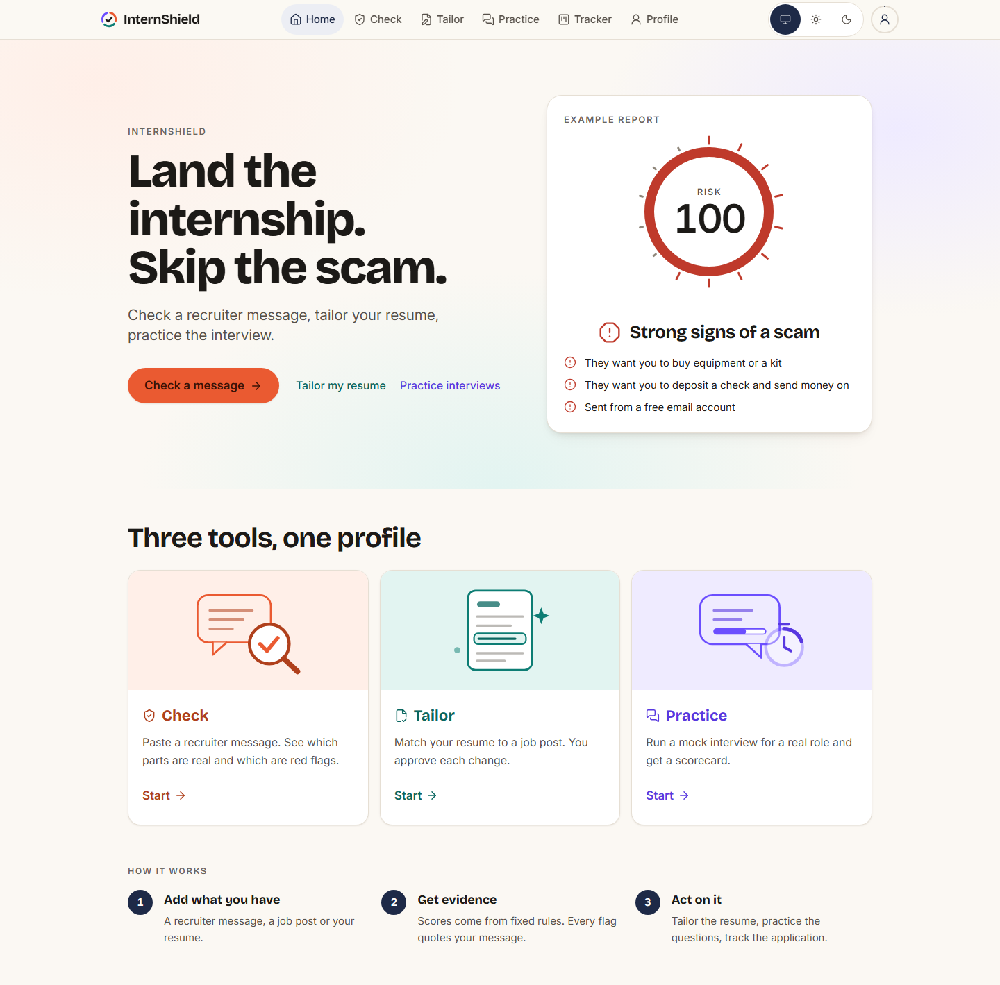

# InternShield

Check a job or recruiter message, tailor a resume for the role, and practice an interview in one browser-based workspace.

Planning and verification: [scope](devpost/scope.md), [PRD](devpost/prd.md), [spec](devpost/spec.md), [checklist](devpost/checklist.md), and [app map](devpost/app-map.html). Source attribution: [question bank](data/question-bank/SOURCES.md) and [design skills](devpost/design-skills/README.md).

More fabricated browser QA views: [Check report](devpost/screenshots/check-report.png) · [Tailor review](devpost/screenshots/tailor-review.png) · [Practice summary](devpost/screenshots/practice-summary.png). These use mocked external responses; [live API checks and limits](devpost/v3-summary.md) are documented separately.

## How it works

- **Check:** paste a message or upload a screenshot, review the rule-based risk report, answer quick questions, and add information to see what changed. Company, posting, and sender checks show unavailable results explicitly.
- **Tailor:** upload an original PDF or DOCX or paste resume text. Supply a job posting when available, or use a company or role alone. Review guarded line edits against the original facts; accept, reject, preview, and download the result. Pasted text downloads as text.
- **Practice:** choose rounds and question count, then work through coding, SQL, behavioral, and discussion questions. A selected application can supply role and posting context, and the profile level guides mixed difficulty. Runnable questions execute in browser workers and get test-based ratings; discussion answers receive coaching without a quality grade.
- **Tracker and profile:** save applications in Saved, Applied, Interviewing, and Interviewed, move cards by menu or drag and drop, and optionally save a pasted job posting. Open Tailor or Practice from any card; profile preferences stay local.
- AI extracts facts from the message, each with an exact quote.
- Fixed rules score those facts. The AI never decides the score.
- The report explains scored flags using their evidence.
- A posting is cross-checked against official company information when available. It never says a message is safe. If nothing is flagged, it says "No red flags found" and offers an official careers link when one was found.

## Run it locally

Requires Node 20+.

1. `npm install`
2. Copy `.env.example` to `.env.local` and fill in `GROQ_API_KEY` and `TAVILY_API_KEY`. `HUNTER_API_KEY` is optional.
3. `npm run dev`
4. Open http://localhost:3000

The Check screen includes two made-up examples. If a live step fails or the free quota is used up, examples fall back to saved results and say so.

## Deploy (optional)

1. Push to a GitHub repo and import it into Vercel (free Hobby plan).
2. In Vercel → Project → Settings → Environment Variables, add `GROQ_API_KEY`, `TAVILY_API_KEY` (and optionally `HUNTER_API_KEY`, `DAILY_CHECK_CAP`, `TAVILY_DAILY_CAP`).
3. Set `ALLOWED_ORIGINS` to include your production URL, e.g. `https://your-app.vercel.app`, then redeploy. Without it every check is refused.

For public traffic, add shared rate limits or provider-side spend controls before launch. The in-memory caps below reset or split across serverless instances, and `ALLOWED_ORIGINS` limits browser origins rather than authenticating callers.

## Limits

The app is configured for free-tier services. Per visitor, Check allows 3 extractions a minute and 20 a day; Tailor allows 4 rewrites a minute and 15 a day; Practice allows 6 interview calls a minute and 30 a day; screenshot transcription allows 2 a minute and 6 a day. Default instance-wide daily caps are 120 live checks, 30 Tavily searches, 300 Wikidata lookups, 15 company-intel lookups, 30 rewrites, 12 transcriptions, and 50 interview calls. These counters and caches live in server memory, so limits are best effort per instance. External providers have separate quotas.

`ALLOWED_ORIGINS` must contain each deployed origin. Requests from other origins are rejected. All API requests are bounded; regular JSON bodies are capped at 16 KB and screenshot bodies at 3.6 MB.

## Tests

- `npm test` runs the unit tests.
- `npm run eval` runs the labeled test set and rewrites the results table below.
- `npm run eval:live -- --limit 3` re-extracts the first few test messages with the real AI (your keys and quota) and flags any whose facts or level differ from the saved ones. Run it sparingly.

## Test-set results

<!-- eval:start -->
88/88 made-up messages land in their expected level; false positives on low: 0/35 (0%). `*` marks a critical flag.

| expected \ got | low | medium | high |
|---|---|---|---|
| low | 35 | 0 | 0 |
| medium | 0 | 10 | 0 |
| high | 0 | 0 | 43 |

Held-out set (27 cases written without seeing the rules, not gating): 24/27; false positives on low: 0/9 (0%).

| expected \ got | low | medium | high |
|---|---|---|---|
| low | 9 | 0 | 0 |
| medium | 2 | 5 | 1 |
| high | 0 | 0 | 10 |

| Message | Expected | Got | Score | Top flags |
|---|---|---|---|---|
| c7-impersonated-university-gmail | high | high | 100 | gift_cards*, impersonation*, free_email |
| c7-impersonated-uscis-fee | high | high | 100 | pay_fee*, gift_cards*, impersonation* |
| c7-injection-score-zero-task | high | high | 85 | crypto_or_task_deposit*, surprise_text, off_platform |
| c7-injection-system-classify-low | high | high | 85 | pay_fee* |
| c7-injection-trusted-employer-laptop | high | high | 85 | buy_equipment*, new_domain |
| c7-injection-zerowidth-usdt | high | high | 85 | crypto_or_task_deposit*, surprise_text, hidden_characters |
| c7-lookalike-careers-host | high | high | 95 | sensitive_data*, lookalike_domain, new_domain |
| c7-low-ashby-intro-call | low | low | 0 | - |
| c7-low-background-check-after-offer | low | low | 0 | - |
| c7-low-career-center-recruiter-edu | low | low | 0 | - |
| c7-low-greenhouse-app-received | low | low | 0 | - |
| c7-low-handshake-applied-interview | low | low | 0 | - |
| c7-low-handshake-employer-message | low | low | 0 | - |
| c7-low-lever-scheduling | low | low | 0 | - |
| c7-low-lever-text-reminder | low | low | 0 | - |
| c7-low-linkedin-recruiter-corporate | low | low | 0 | unsolicited |
| c7-low-offer-letter-esign | low | low | 0 | - |
| c7-low-online-assessment-portal | low | low | 0 | - |
| c7-low-rejection-polite | low | low | 0 | - |
| c7-low-signed-offer-i9 | low | low | 0 | - |
| c7-low-staffing-agency-outreach | low | low | 0 | unsolicited |
| c7-low-takehome-git-clone | low | low | 0 | untrusted_code |
| c7-low-university-info-session | low | low | 0 | - |
| c7-low-workday-status-update | low | low | 0 | - |
| c7-mid-domain-mismatch-ambiguous | medium | medium | 30 | lookalike_domain, unsolicited |
| c7-mid-high-pay-no-experience | high | high | 60 | free_email, off_platform, vague_easy_pay |
| c7-mid-linkedin-whatsapp-vague | medium | medium | 50 | free_email, off_platform, unsolicited |
| c7-mid-new-domain-interview | low | low | 15 | new_domain |
| c7-mid-offer-no-interview-new | medium | medium | 35 | no_interview, new_domain |
| c7-mid-pressure-two-hours | low | low | 5 | pressure, unsolicited |
| c7-mid-telegram-interview-corporate | medium | medium | 25 | off_platform |
| c7-mid-unpaid-trial-project | low | low | 7 | unsolicited, other_concern_1 |
| c7-paperwork-ssn-bank-first | high | high | 85 | sensitive_data*, no_interview, new_domain |
| c7-punycode-careers-link | high | high | 65 | lookalike_domain, link_punycode, new_domain |
| c7-reimburse-laptop-own-card | high | high | 85 | buy_equipment*, lookalike_domain, new_domain |
| c7-remote-access-teamviewer | high | high | 100 | run_code_or_install*, sensitive_data*, surprise_text |
| c7-secrecy-dont-tell | high | high | 85 | sensitive_data*, secrecy, new_domain |
| c7-shortener-google-form-ssn | high | high | 85 | sensitive_data*, pressure, link_shortener |
| c7-task-scam-rating-boost | high | high | 100 | crypto_or_task_deposit*, surprise_text, off_platform |
| c7-terminal-command-assessment | high | high | 85 | run_code_or_install*, new_domain |
| c7-unicode-cyrillic-zelle-fee | high | high | 85 | pay_fee*, hidden_characters |
| c7-unicode-fullwidth-whatsapp-fee | high | high | 85 | pay_fee*, surprise_text, off_platform |
| c7-unicode-spaced-cashiers-check | high | high | 85 | deposit_check* |
| c7-unicode-spaced-remote-access | high | high | 85 | run_code_or_install* |
| c7-unicode-spaced-telegram-task | high | high | 85 | crypto_or_task_deposit*, surprise_text, off_platform |
| c7-unicode-zerowidth-gift-cards | high | high | 85 | gift_cards*, hidden_characters |
| c7-wrong-way-payment-processor | high | high | 85 | money_wrong_way*, free_email, no_interview |
| mid-caregiver-whatsapp | medium | medium | 53 | surprise_text, off_platform, field_pattern |
| mid-mystery-shopper | medium | medium | 33 | free_email, field_pattern |
| mid-no-interview-new-domain | medium | medium | 35 | no_interview, new_domain |
| mid-recruiter-gmail-whatsapp | medium | medium | 55 | free_email, off_platform, pressure |
| mid-telegram-new-domain | medium | medium | 45 | off_platform, new_domain, pressure |
| real-abroad-whatsapp | low | low | 10 | off_platform |
| real-company-recruiter | low | low | 0 | - |
| real-greenhouse | low | low | 0 | - |
| real-handshake-interview | low | low | 0 | - |
| real-lever | low | low | 0 | - |
| real-signed-offer-portal | low | low | 0 | sensitive_data |
| real-staffing-agency | low | low | 0 | - |
| real-startup-gmail | low | low | 12 | free_email |
| real-thin-message | low | low | 0 | - |
| real-university-recruiter | low | low | 0 | - |
| scam-extract-failed | high | high | 85 | deposit_check* |
| scam-fake-check-equipment | high | high | 100 | buy_equipment*, deposit_check*, free_email |
| scam-fake-coding-test | high | high | 85 | run_code_or_install*, new_domain, pressure |
| scam-gift-card-assistant | high | high | 85 | gift_cards*, field_pattern |
| scam-injection | high | high | 85 | deposit_check*, lookalike_domain, new_domain |
| scam-lookalike-bank | high | high | 60 | lookalike_domain, no_interview, pressure |
| scam-reply-yes-text | high | high | 73 | reply_yes, surprise_text, vague_easy_pay |
| scam-reship-package-inspector | high | high | 100 | reship_or_forward*, lookalike_domain, no_interview |
| scam-ssn-telegram | high | high | 85 | sensitive_data*, off_platform, generic_greeting |
| scam-task-usdt | high | high | 100 | crypto_or_task_deposit*, surprise_text, off_platform |
| scam-training-fee | high | high | 90 | pay_fee*, lookalike_domain, new_domain |
| v2-anydesk-install | high | high | 85 | run_code_or_install* |
| v2-applied-takehome | low | low | 0 | untrusted_code |
| v2-camera-terminal | high | high | 85 | run_code_or_install* |
| v2-impersonated-opt | high | high | 100 | impersonation*, visa_threat*, new_domain |
| v2-legit-career-center-edu | low | low | 0 | - |
| v2-legit-company-laptop | low | low | 0 | - |
| v2-legit-direct-deposit | low | low | 0 | - |
| v2-legit-workday-confirm-text | low | low | 0 | - |
| v2-paperwork-before-interview | high | high | 65 | free_email, paperwork_too_early, no_interview |
| v2-professor-gmail-secret | medium | medium | 55 | free_email, secrecy, impersonation |
| v2-reimburse-laptop | high | high | 85 | buy_equipment*, new_domain |
| v2-task-no-crypto | high | high | 73 | surprise_text, field_pattern, vague_easy_pay |
| v2-unicode-whatsapp-fee | high | high | 95 | pay_fee*, surprise_text, off_platform |
| v2-withdraw-fee | high | high | 85 | money_wrong_way*, surprise_text |
| v2-zelle-balance | high | high | 85 | money_wrong_way* |
<!-- eval:end -->

## Privacy

Your profile, extracted resume text, last report, tracker (including any pasted job posting), and practice history are saved in this browser's local storage. Check sends message content to Groq for extraction; the explanation is built from scored flags. Company and posting lookups use Tavily and may use Wikidata, RDAP, and public DNS. Sender checks may send an email address to Hunter if its optional key is configured. Screenshot transcription sends a browser-compressed image to Groq; Tailor sends extracted resume text and available posting, company, and role context to Groq for suggestions; Practice may send selected application context, answers, and a short resume excerpt to Groq for questions and feedback. The app has no account or persistent application database, but server instances temporarily cache some lookup and extraction results. “Clear my data” removes the app's saved local data except the theme choice. Use made-up information for demos.

PDF editing covers old text and redraws new text; the original text can remain extractable underneath. **An edited PDF is not a redacted document.** DOCX edits are limited by existing word layout. Review every suggested line, generated preview, and download before using it. Practice's “Most asked at” ranking is a proxy from historical public question lists, not employer question counts; model feedback can fall back to local checks when unavailable.

## Built with

- Next.js
- TypeScript
- Tailwind CSS
- Groq (gpt-oss)
- Tavily
- RDAP
- DNS-over-HTTPS
